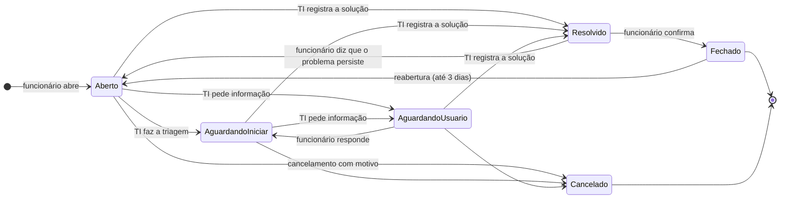
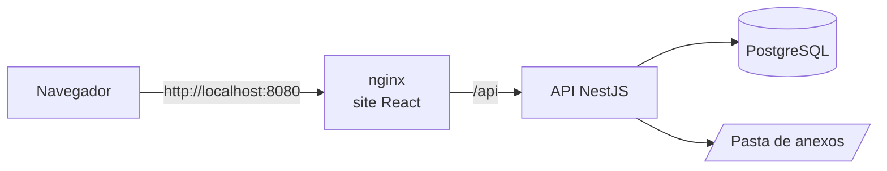

<div align="center">

# 🆘 Me Socorre Aki

**Sistema de Help Desk interno: funcionários pedem ajuda, a TI atende e tudo fica registrado.**


</div>

> **Status:** projeto de portfólio, feito para rodar no seu computador. A empresa, as pessoas e os chamados são fictícios.

<details>
<summary><strong>📑 Sumário</strong></summary>

1. [O que é o projeto](#-o-que-é-o-projeto)
2. [O que cada perfil faz](#-o-que-cada-perfil-faz)
3. [A vida de um chamado](#-a-vida-de-um-chamado)
4. [Tecnologias](#-tecnologias)
5. [Como rodar (passo a passo)](#-como-rodar-passo-a-passo)
6. [Primeiro passeio pelo sistema](#-primeiro-passeio-pelo-sistema)
7. [Rodar sem Docker (para desenvolver)](#-rodar-sem-docker-para-desenvolver)
8. [Testes](#-testes)
9. [Como o código está organizado](#-como-o-código-está-organizado)
10. [Decisões técnicas](#-decisões-técnicas)
11. [Segurança](#-segurança)
12. [Configurações (.env)](#-configurações-env)
13. [Problemas comuns](#-problemas-comuns)
14. [Fora do escopo e próximos passos](#-fora-do-escopo-e-próximos-passos)

</details>

---

## 💡 O que é o projeto

Em muitas empresas, quem precisa de ajuda da TI manda mensagem, liga ou chama no corredor. Os pedidos se perdem, ninguém sabe quem está cuidando de quê e não sobra histórico do que foi feito.

O **Me Socorre Aki** organiza isso:

- o funcionário **abre um chamado** dizendo o problema e o serial do equipamento;
- a TI vê tudo numa **fila**, assume o chamado, conversa com quem pediu e registra a solução;
- cada passo fica no **histórico**: quem fez, quando e por quê;
- o administrador cuida dos **cadastros** e acompanha **relatórios**.

O foco do projeto é o **backend**: login seguro, permissões conferidas no servidor, regras de negócio claras e testes automatizados contra um banco de dados real.

---

## 👥 O que cada perfil faz

| Perfil | O que pode fazer |
|--------|------------------|
| 🙋 **Funcionário** | Abre chamados (com anexos), acompanha **só os próprios**, responde perguntas da TI, confirma a solução ou diz que o problema continua, reabre em até 3 dias e cancela o que não precisa mais. |
| 🛠️ **Técnico de TI** | Vê a fila com filtros, assume chamados, confirma ou ajusta a prioridade, pede informações, escreve **observações internas** (que o funcionário não vê) e registra a solução. |
| 👑 **Administrador** | Tudo que o técnico faz, mais: cadastra usuários, setores, categorias e equipamentos, distribui chamados entre técnicos, ajusta as regras de prioridade e vê os relatórios. |

Algumas regras importantes:

- 🔒 Um funcionário **nunca** vê o chamado de outro, nem trocando o número na URL.
- 🏷️ A **prioridade** é sugerida automaticamente a partir das respostas de impacto (quantas pessoas afetadas, se dá para trabalhar etc.). O técnico pode mudar, mas precisa justificar.
- 💻 Se o serial do equipamento ainda não estiver cadastrado, o chamado **abre mesmo assim** e fica marcado como pendente. Quando o equipamento é cadastrado, o vínculo é feito sozinho.
- 🔔 As **notificações** avisam quando algo muda nos seus chamados.

---

## 🔄 A vida de um chamado

Todo chamado passa por estes status. Cada seta é uma ação, e o sistema não deixa pular etapas.



| Status | O que significa |
|--------|-----------------|
| **Aberto** | Acabou de chegar (ou voltou) e espera a TI olhar. |
| **Aguardando iniciar** | A TI já viu e definiu a prioridade; está na fila para ser feito. |
| **Aguardando usuário** | A TI fez uma pergunta e espera a resposta do funcionário. |
| **Resolvido** | A TI registrou a solução; falta o funcionário confirmar. |
| **Fechado** | O funcionário confirmou. Pode ser reaberto por até 3 dias, com motivo. |
| **Cancelado** | Encerrado sem solução, sempre com justificativa. |

Ações como pedir informação, resolver, recusar a solução, reabrir e cancelar **exigem um texto** explicando o motivo, e tudo vai para o histórico.

---

## 🧰 Tecnologias

| Parte | Tecnologia | Para que serve |
|-------|------------|----------------|
| API | **NestJS 11** + TypeScript | Organiza o backend em módulos (chamados, usuários, anexos...). |
| Banco | **PostgreSQL 16** + **Prisma 6** | Guarda os dados; o Prisma cria as tabelas por migrações versionadas. |
| Tela | **React 19** + Vite | Interface web (SPA). |
| Dados na tela | TanStack Query, react-hook-form, zod | Busca dados da API, formulários e validação. |
| Execução | **Docker Compose** + nginx | Sobe banco, API e site com um comando. |
| Testes | Jest, Supertest, Vitest, Testing Library | Testes da API (com banco real) e da interface. |
| Documentação da API | Swagger | Página interativa para testar os endpoints. |

---

## 🚀 Como rodar (passo a passo)

O jeito mais fácil é com o **Docker**: ele instala e liga tudo sozinho (banco, API e site). Você não precisa instalar Node nem PostgreSQL.

### 1. Instale o que é preciso

- **Git**: [git-scm.com](https://git-scm.com/downloads)
- **Docker Desktop** (Windows/Mac) ou Docker Engine (Linux): [docker.com](https://www.docker.com/products/docker-desktop/)

Depois de instalar, **abra o Docker Desktop** e espere ele dizer que está rodando.

### 2. Baixe o projeto

```bash
git clone <url-deste-repositório>
cd projeto-suporte-ti
```

### 3. Crie o arquivo de configuração

Copie o modelo `.env.example` para um arquivo chamado `.env`:

```bash
cp .env.example .env          # Linux, Mac ou Git Bash
copy .env.example .env        # Prompt de Comando do Windows
```

Abra o `.env` num editor de texto e troque as duas senhas:

```env
POSTGRES_PASSWORD=uma-senha-para-o-banco
SEED_PASSWORD=uma-senha-para-os-usuarios-de-demo
```

> A `SEED_PASSWORD` é a senha que você vai usar para entrar com os usuários de demonstração.

### 4. Ligue tudo

```bash
docker compose up --build
```

Na primeira vez demora alguns minutos (o Docker baixa as imagens e compila o projeto). Quando parar de rolar texto no terminal, está pronto.

Na primeira subida, o sistema cria as tabelas e preenche o banco com **dados de demonstração**: 5 setores, 15 usuários, 40 equipamentos e 500 chamados em todos os status.

### 5. Abra no navegador

| O quê | Endereço |
|-------|----------|
| 🖥️ Sistema | http://localhost:8080 |
| 📘 Documentação da API (Swagger) | http://localhost:8080/api/docs |

### 6. Entre com um usuário de demonstração

Todos usam a senha que você colocou em `SEED_PASSWORD`.

| Login | Perfil | Para que usar |
|-------|--------|---------------|
| `helena` | 👑 Administrador | Ver tudo: cadastros, relatórios e regras de prioridade |
| `marcos` ou `julia` | 🛠️ Técnico de TI | Atender a fila |
| `paula`, `carlos`, `renata`, `diego` | 🙋 Funcionário | Abrir e acompanhar chamados |
| `renato` | 🙋 Funcionário | Conta **desativada**: serve para ver o login sendo recusado |

### Para desligar

Aperte `Ctrl + C` no terminal, ou rode:

```bash
docker compose down        # desliga e mantém os dados
docker compose down -v     # desliga e APAGA os dados (o próximo "up" recria a demo)
```

---

## 🧭 Primeiro passeio pelo sistema

Um roteiro de 10 minutos que passa pelas partes mais interessantes:

1. **Como `paula` (funcionária):** abra um chamado com o serial `NB-10000` (equipamento cadastrado) e outro com `XX-1` (serial desconhecido). Repare que o segundo abre normalmente, marcado como pendente.
2. **Como `marcos` (técnico):** assuma o primeiro chamado, confirme a prioridade, peça uma informação e escreva uma **observação interna**.
3. **Volte como `paula`:** responda à pergunta. Note que a observação interna **não aparece** para ela.
4. **Como `marcos`:** registre a solução.
5. **Como `paula`:** confirme a resolução (o chamado fecha) e depois peça a reabertura, informando um motivo.
6. **Como `helena` (admin):**
   - cadastre um usuário novo: a senha temporária aparece **uma única vez**, e ele será obrigado a trocá-la no primeiro acesso;
   - cadastre o equipamento `XX-1`: o chamado pendente da paula é vinculado sozinho;
   - abra os **Relatórios** e veja os números de hoje, 7 e 30 dias.

---

## 🧑‍💻 Rodar sem Docker (para desenvolver)

Útil se você quiser mexer no código e ver as mudanças na hora.

**Requisitos:** Node.js 22 ou superior e um PostgreSQL rodando (local ou em contêiner).

**Terminal 1: API**

```bash
cd backend
cp .env.example .env              # ajuste DATABASE_URL para o seu PostgreSQL
npm install
npx prisma migrate deploy         # cria as tabelas
npm run seed                      # opcional: dados de demonstração (usa SEED_PASSWORD)
npm run start:dev                 # API em http://localhost:3000
```

**Terminal 2: site**

```bash
cd frontend
npm install
npm run dev                       # site em http://localhost:5173
```

O site de desenvolvimento repassa as chamadas de `/api` para a API na porta 3000.

---

## ✅ Testes

O projeto tem **194 testes automatizados**:

| Tipo | Quantidade | O que verificam |
|------|-----------:|-----------------|
| Unitários (backend) | 96 | Regras isoladas: transições de status, prioridade, validação de arquivos, senhas... |
| Integração (backend) | 74 | A API inteira, com **PostgreSQL de verdade**: login, permissões, ciclo do chamado, anexos, relatórios |
| Interface (frontend) | 24 | Componentes e o que cada perfil pode ver e fazer na tela |

```bash
cd backend
npm test              # unitários
npm run test:e2e      # integração (sobe um PostgreSQL temporário sozinho)
npm run lint          # checagem de tipos do TypeScript

cd ../frontend
npm test              # testes da interface
```

> **Não precisa de Docker para os testes de integração.** Eles ligam um PostgreSQL temporário (`embedded-postgres`) na porta 15432. Para usar outra porta, defina `TEST_DB_PORT`. Para usar um banco que já existe, defina `TEST_DATABASE_URL`.

Os módulos mais críticos (chamados, autenticação e controle de acesso) têm entre **80% e 89%** de cobertura.

---

## 🗂️ Como o código está organizado



```text
.
├── backend/                 API NestJS
│   ├── prisma/              modelo do banco, migrações e dados de demonstração
│   ├── src/
│   │   ├── auth/            login, sessão e senha
│   │   ├── access/          regra de quem pode ver cada chamado
│   │   ├── tickets/         chamados e a máquina de estados
│   │   ├── comments/        conversa pública e observações internas
│   │   ├── attachments/     upload, validação e download de anexos
│   │   ├── equipment/       cadastro de equipamentos
│   │   ├── users/           cadastro de usuários
│   │   ├── catalog/         setores e categorias
│   │   ├── priority-rules/  pesos e faixas da prioridade sugerida
│   │   ├── notifications/   notificações
│   │   └── reports/         relatórios
│   └── test/                testes de integração
├── frontend/                site React (páginas, componentes, hooks)
├── docker-compose.yml       liga banco + API + site
└── .claude/sdd/archive/     documentos de planejamento (ideia → requisitos → design → entrega)
```

Os documentos em `.claude/sdd/archive/HELP_DESK/` contam como o projeto foi planejado: requisitos, decisões de arquitetura, relatório de construção e lições aprendidas.

---

## 🧠 Decisões técnicas

- **Monólito modular.** Um módulo por assunto, sem dependências circulares. É simples de rodar e de entender, e cada parte tem fronteiras claras.
- **Sessão guardada no servidor**, não JWT. O navegador recebe um cookie `httpOnly` com um token aleatório, e o banco guarda só o *hash* dele. Assim, desativar uma conta ou trocar a senha **derruba a sessão na hora**.
- **Máquina de estados explícita.** Todas as transições de status estão numa tabela única ([ticket-state-machine.ts](backend/src/tickets/ticket-state-machine.ts)), que diz de onde para onde se pode ir, quem pode fazer e se precisa de motivo.
- **Concorrência tratada.** Se dois técnicos tentam assumir o mesmo chamado ao mesmo tempo, só o primeiro consegue; o segundo recebe um aviso.
- **Histórico separado dos comentários.** O histórico (`ticket_events`) só aceita inclusões, nunca edição. Ele é gravado na mesma transação da mudança, então não existe mudança sem registro.
- **Uma regra de visibilidade, num lugar só** ([ticket-access.policy.ts](backend/src/access/ticket-access.policy.ts)). Lista, detalhe, comentários e anexos usam a mesma regra.
- **Datas em UTC** no banco; relatórios no fuso configurado em `APP_TIMEZONE`.

---

## 🔐 Segurança

| Proteção | Como funciona |
|----------|---------------|
| Senhas | Guardadas com **argon2id**; conta nova é obrigada a trocar a senha. |
| Sessão | Cookie `httpOnly` e `SameSite=Lax`, expira em 8 horas. |
| Permissões | Toda rota exige login e perfil por padrão; um funcionário que tenta abrir o chamado de outro recebe 404, como se ele não existisse. |
| CSRF | Ações que alteram dados exigem o cabeçalho `X-Requested-With`. |
| Força bruta | No máximo 5 tentativas de login por minuto para cada combinação de IP e login. |
| Anexos | Só PNG, JPG e PDF de até 5 MB, conferidos pelo **conteúdo** do arquivo (não pela extensão), salvos fora de pastas públicas. |
| Entrada de dados | Campos validados; campos inesperados são recusados. |

> Este projeto foi feito para rodar **localmente**. Para publicar na internet seria preciso, no mínimo, HTTPS, `COOKIE_SECURE=true`, cabeçalhos de segurança no nginx e `SEED_ON_START=false`.

---

## ⚙️ Configurações (.env)

As principais variáveis do arquivo `.env` da raiz:

| Variável | Padrão | O que faz |
|----------|--------|-----------|
| `POSTGRES_PASSWORD` | — | Senha do banco. **Troque.** |
| `SEED_PASSWORD` | — | Senha dos usuários de demonstração. **Troque.** |
| `SEED_ON_START` | `true` | Cria os dados de demonstração quando o banco está vazio. |
| `WEB_PORT` | `8080` | Porta do site no seu computador. |
| `COOKIE_SECURE` | `false` | Use `true` só se estiver com HTTPS. |

Outras opções da API (em [backend/.env.example](backend/.env.example)): duração da sessão, tamanho máximo dos anexos, prazo de reabertura, tamanho mínimo da senha, fuso dos relatórios e limite de tentativas de login.

### Backup dos dados

Os dados ficam em dois volumes do Docker, que devem ser copiados **juntos**:

- `pgdata`: o banco. Para exportar: `docker compose exec db pg_dump -U helpdesk mesocorreaki > backup.sql`
- `uploads`: os arquivos anexados.

---

## 🩺 Problemas comuns

| Problema | Solução |
|----------|---------|
| `port is already allocated` ao subir | A porta 8080 está em uso. Mude `WEB_PORT` no `.env` (ex.: `8081`) e acesse essa porta. |
| `Cannot connect to the Docker daemon` | O Docker Desktop não está aberto. Abra e espere ficar pronto. |
| Login recusado com a senha certa | A senha é a do `SEED_PASSWORD` **da primeira subida**. Se mudou depois, rode `docker compose down -v` e suba de novo. |
| Muitas tentativas de login | O limite é por minuto; espere um minuto e tente outra vez. |
| Quero começar do zero | `docker compose down -v` e depois `docker compose up --build`. |

---

## 🗺️ Fora do escopo e próximos passos

Ficaram de fora desta primeira versão, de propósito:

- [ ] E-mail e login com Microsoft 365 / Active Directory
- [ ] Prazos de atendimento (SLA) e distribuição automática de chamados
- [ ] Exportação de relatórios em PDF ou Excel e período personalizado
- [ ] Base de conhecimento
- [ ] Recuperação de senha pelo próprio usuário (hoje o administrador redefine)
- [ ] Teste ponta a ponta no navegador (ex.: Playwright)
